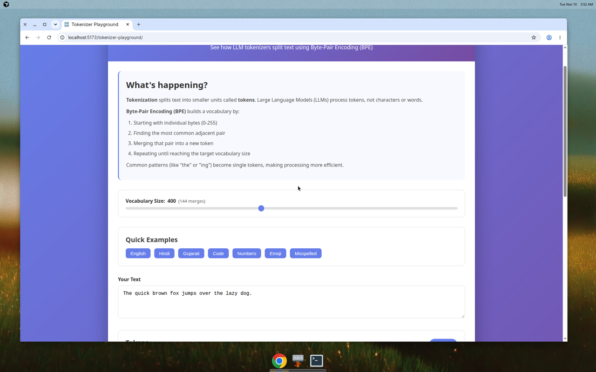

# 🔤 Tokenizer Playground

An interactive web application that teaches how Large Language Model (LLM) tokenizers split text using Byte-Pair Encoding (BPE). Type any text and watch it break into color-coded tokens in real-time, step through the merge process, and compare with production tokenizers.

**[🚀 Live Demo](https://fagun98.github.io/tokenizer-playground/)**



## What It Does

Large Language Models don't process text as characters or words—they process **tokens**. This playground shows you exactly how tokenization works:

- **See tokens visually**: Type any text and instantly see it split into color-coded tokens with IDs
- **Step through merges**: Start from individual bytes and watch the BPE algorithm merge common pairs step by step
- **Compare tokenizers**: See how your BPE tokenizer compares to GPT-4's tiktoken with cost estimates
- **Try diverse examples**: Pre-loaded examples show how tokenization handles English, Hindi, Gujarati, code, numbers, emoji, and misspellings

## How BPE Works Here

Byte-Pair Encoding builds a vocabulary by iteratively merging common patterns:

1. **Start with bytes**: Begin with 256 tokens (one for each byte value 0-255)
2. **Count pairs**: Find the most frequently occurring pair of adjacent tokens in your training text
3. **Merge the pair**: Create a new token representing that pair and replace all occurrences
4. **Repeat**: Continue until you reach your target vocabulary size

Common sequences like "the", "ing", or "tion" become single tokens, making text compression more efficient and helping models process language patterns.

## What I Learned / Why It Matters

Building this taught me:

- **BPE fundamentals**: Implemented the algorithm from scratch to deeply understand how tokenizers compress text and why they behave differently across languages
- **Tokenization trade-offs**: Smaller vocabularies mean more tokens per text (slower, costlier); larger vocabularies mean rarer tokens that models see less often during training
- **Real cost impact**: Token counts directly affect API costs—the same text can cost 2-3x more in some languages (like Hindi) versus English with GPT tokenizers
- **Browser-side ML**: Bundled a trained tokenizer that runs entirely in the browser with no API keys or server required

Tokenization matters because it's the first step in every LLM interaction, affects inference speed and cost, and creates subtle biases (English is often more "efficient" than other languages).

## Run Locally

```bash
# Clone the repository
git clone https://github.com/fagun98/tokenizer-playground.git
cd tokenizer-playground

# Install dependencies
npm install

# Run development server
npm run dev
```

Open [http://localhost:5173](http://localhost:5173) in your browser.

## Run Tests

```bash
npm test
```

Tests cover:
- BPE training on various inputs
- Encode/decode round-trips
- Token count reduction validation
- Unicode handling
- Partial merge application for step-through view

## Build for Production

```bash
npm run build
```

The built files will be in the `dist/` directory, ready for deployment.

## Files

| File | What It Does |
|------|--------------|
| `src/bpe.ts` | From-scratch BPE tokenizer implementation (train, encode, decode, step-through) |
| `src/bpe.test.ts` | Test suite for BPE logic (training, encoding, round-trips) |
| `src/corpus.ts` | Small training corpus and pre-defined examples |
| `src/tiktoken-wrapper.ts` | Wrapper for js-tiktoken (GPT-4 tokenizer comparison) |
| `src/utils.ts` | Utilities for token colors, display formatting, cost estimation |
| `src/App.tsx` | Main React component with UI panels |
| `src/App.css` | Responsive styles (mobile-friendly) |
| `.github/workflows/ci.yml` | GitHub Actions workflow for tests and build checks |
| `.github/workflows/deploy.yml` | GitHub Actions workflow for automatic deployment to GitHub Pages |

## Deploy

This project deploys automatically to GitHub Pages via GitHub Actions on every push to `main`.

**First-time setup** (repository owner only):

1. Go to **Settings** > **Pages** in your GitHub repository
2. Under **Source**, select **GitHub Actions**
3. Push to `main` to trigger deployment

The site will be available at `https://fagun98.github.io/tokenizer-playground/`

## Tech Stack

- **React** + **TypeScript** for the UI
- **Vite** for fast development and optimized builds
- **js-tiktoken** for GPT-4 tokenizer comparison
- **Vitest** for testing
- **GitHub Actions** for CI/CD
- **GitHub Pages** for free static hosting

## License

MIT License - see [LICENSE](LICENSE) for details.

---

Built by **Fagun Raithatha** • [GitHub](https://github.com/fagun98) • [LinkedIn](https://www.linkedin.com/in/fagun-raithatha/)
